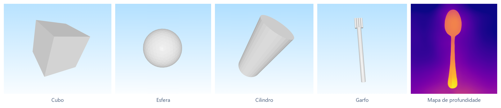

<h1 align="center">3D Reconstruction from 2D Images</h1>

Ferramenta do meu TCC que transforma uma foto comum em um modelo 3D. Ela tira o fundo da imagem, estima a profundidade de cada pixel com inteligência artificial e monta a malha 3D a partir disso, pronta para abrir no Blender.

  

  

## Destaques

- **Uma foto basta:** o modelo 3D sai de uma única imagem, sem precisar fotografar o objeto de vários ângulos.
- **Profundidade por IA:** o MiDaS, rede neural treinada para estimar distância, diz o quanto cada pixel está perto ou longe.
- **Fundo removido sozinho:** o objeto principal é separado do resto antes de virar 3D.
- **Saída em `.obj`:** formato aberto que o Blender e outros programas de modelagem leem direto.
- **Interface simples:** uma janela para escolher a imagem e gerar o modelo, com o andamento de cada etapa na tela.

## Como foi feito

O projeto começou pelo básico, gerando formas simples em 3D, e foi ganhando etapas até chegar ao caminho completo da foto ao modelo.

<strong>O caminho da foto ao modelo 3D</strong>

1. **Preparo:** a imagem é redimensionada para 256x256 e normalizada.
2. **Fundo:** o `rembg` separa o objeto principal do resto.
3. **Profundidade:** o MiDaS_small, carregado pelo PyTorch Hub, recebe a imagem em 384x384 e estima a profundidade de cada pixel.
4. **Malha:** cada pixel vira um vértice, cada quadrado da grade vira dois triângulos e o resultado é gravado em `.obj`.
5. **Visualização:** o modelo pode ser conferido na hora com o Matplotlib.
6. **Interface:** a janela em Tkinter roda o processo numa thread separada, então não trava enquanto o modelo é gerado.

<strong>Visão computacional</strong>

- **Primeiros passos com OpenCV:** leitura, manipulação de pixels, mistura de imagens e preenchimento de bordas.
- **Contornos:** detecção por limiarização.
- **Remoção de fundo sem IA:** Canny, escolha do maior contorno e máscara aplicada sobre a imagem.
- **Formas básicas:** cubo, esfera, cilindro, pirâmide e outras, geradas com o Trimesh e exportadas em `.obj`.
- **Nuvem de pontos:** o mapa de profundidade do MiDaS DPT_Large vira nuvem de pontos no Open3D, salva em `.ply`.

<strong>Modelo de inteligência artificial</strong>

- **MNIST:** uma rede convolucional em TensorFlow para entender o ciclo de treino.
- **Autoencoder em PyTorch:** a imagem de 64x64 vira 1024 valores, que viram uma grade de voxels com convoluções 3D.
- **Treino:** erro quadrático médio (MSE) com o otimizador Adam.

<strong>Que tipo de imagem funciona melhor</strong>

- **Ajuda:** um objeto só, de frente, com fundo branco ou já removido.
- **Atrapalha:** texto na imagem, vários objetos juntos e fundo cheio de detalhe.

## Tecnologias

- **Linguagem:** Python
- **IA:** PyTorch e torchvision com o MiDaS, e TensorFlow nos primeiros testes
- **Imagem:** OpenCV, Pillow e rembg
- **3D:** Trimesh, Open3D e Matplotlib, com o Blender para conferir
- **Interface:** Tkinter

---

Licença [MIT](LICENSE) · Feito por [Gustavo Victor](https://github.com/guavovic)
